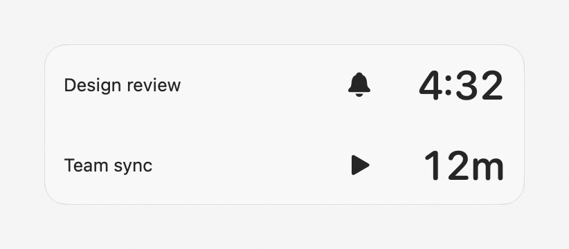
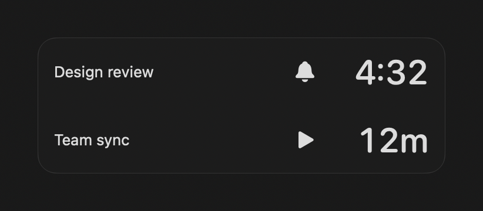

# Meet Meet

**Remember to show up. Remember to wrap up.**

Disclaimer: This is 100% vibe coded. While I'm a developer, I've never written
a line of Swift, and I don't plan to.

I needed Meet Meet because I kept forgetting meetings, and, once I was in one,
I would lose track of when it was supposed to end, or that there was another
meeting right after. Notifications are easy to to miss, and when not missed,
they come as a surprise. I wanted something that not only reminded me, but also
increased my awareness of what was coming up.

Meet Meet is a small macOS menu bar app that counts down to your next meeting
and shows how much time is left in the ones already underway. A quiet reminder
while you're working, and a more obvious nudge when it's time to join.

<p align="center">
  
</p>

## Before the meeting. During the meeting.

- **See what's coming.** A floating countdown sits in the lower-right corner.
  Hover to reveal meeting titles, click a row to open meeting info, or drag the
  whole stack somewhere else.
- **Keep an eye on the finish line.** When a meeting starts, its countdown
  switches to time remaining so you know when to wrap up.
- **Get a final nudge.** Dismissable visual cues appear one minute before start
  and two minutes before end by default. Start cues open meeting info with the
  title, location and a camera-icon **Join** button when a video link is available.
  Info stays open through meeting start; end cues show the title. Configure timing, optional
  sounds, and your own audio or images in **Settings → Cues**.
- **Stay in control.** Hide meetings or recurring series you don't need reminders
  for, temporarily hide a countdown, or use **Pause for Today**.

The countdown and splash appear without taking keyboard focus. Meet Meet lives
in the menu bar, not the Dock. It reads your calendars; it never edits events.

### A look at the countdowns

| Light mode | Dark mode |
| --- | --- |
|  |  |

*Actual HUD rendering with fictional meetings, shown with titles revealed.
The bell means “starts in”; the play icon means “ends in”. Visual cues use
`meet-meet.png` before start and `wrap-wrap.png` before end, in either appearance.*

## Download

**Requires an Apple silicon Mac (M1 or newer) running macOS 26 or newer.**

[**Download the latest release**](https://github.com/nnerik/meet-meet/releases/latest)

 You can run this in Terminal:
 ```bash
 curl -LO https://github.com/nnerik/meet-meet/releases/latest/download/MeetMeet-latest-arm64.dmg
 ```

**A note about macOS security:** releases are ad-hoc signed, not Apple-notarized.
macOS may block first launch. After trying to open the app, use **System Settings
→ Privacy & Security → Open Anyway** only if you trust the download. Don't disable
Gatekeeper; managed Macs may not allow an override.

See the [installation and update guide](docs/installation.md) for the full steps.
Updates are manual, and you may need to grant calendar access again after an
update. Your saved settings should remain in place.

## Your calendar needs to be on your Mac

**Meet Meet only reads calendars available through macOS's local calendar store.**
It doesn't connect directly to Google Calendar or other calendar websites.
A calendar you only use in a browser won't appear until you add its account to
macOS and enable calendar syncing.

This is **not** limited to “On My Mac” calendars: Google, iCloud and other
supported accounts can work once macOS syncs them. Meet Meet relies on that
local copy, so changes may take a little time to arrive.

### Use Google Calendar

1. Open **System Settings → Internet Accounts → Add Account**.
2. Choose **Google** (you may first need to choose from the list of providers),
   sign in, and complete Google's authorization steps.
3. Enable **Calendars** for that account. You don't need to enable Mail or
   Contacts just to use Meet Meet. If the account is already added, select it
   in Internet Accounts and turn on Calendars.
4. Open Apple's **Calendar** app and wait for your Google calendars and events
   to appear. Check that the meetings you want are visible there first.
5. Launch Meet Meet, allow calendar access during setup, and select the calendars
   you want it to watch. Later, use **Settings → Calendars** from its menu.

If a calendar is missing, first check syncing in Apple's Calendar app, then use
**Refresh Calendars** in Meet Meet's menu. Work or school accounts may have
administrator restrictions on adding them to macOS.

Apple's [Internet Accounts instructions](https://support.apple.com/guide/mac-help/add-your-email-and-other-accounts-mh35565/26/mac/26)
explain the system setup in more detail.

## Under the hood

Curious about building it, how reminders behave, or the implementation?
See the [technical guide](docs/technical.md),
[behavior specification](spec.md), and [release workflow](docs/releases.md).

## License

Source code, bundled artwork and sounds are available under the [MIT License](LICENSE).
